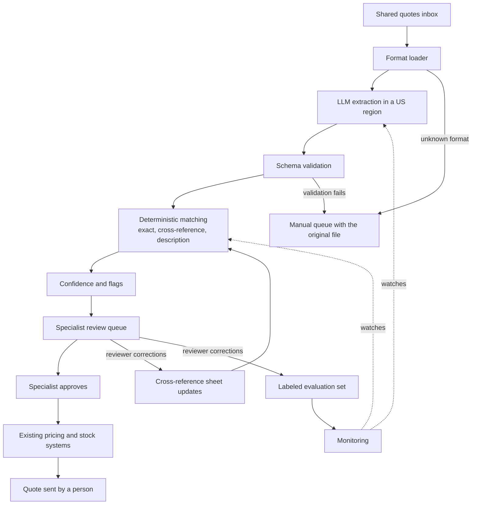

# Ridgeline Quote Desk
## Repository
https://github.com/saitejaramini08/ridgeline-quote-desk
## How to Run

### Setup

```bash
python -m venv .venv
source .venv/bin/activate        # Windows: .venv\Scripts\activate
pip install -r requirements.txt
cp .env.example .env             # Windows: copy .env.example .env
```

Fill in `ANTHROPIC_API_KEY` and `MODEL_ID` in `.env`.

### Run

```bash
python pipeline.py               # extract every RFQ in rfqs/ and match it -> outputs/<rfq>.json
python pipeline.py --match-only  # rerun matching on cached extractions/, no API calls
python evaluate.py               # score against answer_key/ -> evaluation/results.json
python check_submission.py       # check the submission structure
```

## Approach

### Extraction

- One loader per format turns the file into plain text: `.txt` is read directly, `.pdf` with pdfplumber, `.xlsx` with openpyxl (one `|`-joined line per row).
- One LLM call per RFQ (Anthropic API, model from `MODEL_ID`, region REGION_TO_CONFIRM) returns JSON. Pydantic validates it against a fixed schema: the line as written, quantity, unit, part number as written, expanded description, flags for "same as above", "the usual" and thread amendments, and a note.
- The prompt tells the model to copy what is written. It must never invent a quantity or part number and must never output a price. A line it can't fill gets a flag such as `quantity_missing`. If the JSON is invalid, the call is retried once. If it still fails, the RFQ becomes a single `extraction_failed` line for a person to handle.
- The customer is matched against `customers.csv` by name, falling back to the sender's email domain.

### Matching (deterministic, no LLM)

1. **Exact part number**: a written Ridgeline part number in `products.csv` → confidence 0.99.
2. **Cross-reference**: a competitor part number in `cross_reference.csv` → 0.95, or 0.7 with `cross_reference_note` when the row carries a note. If the number maps to more than one Ridgeline part, no part is returned and the line gets `cross_reference_ambiguous`.
3. **Description fallback**: the description is normalised (abbreviations, fractions to decimals, plurals) and scored against active products by rarity-weighted token overlap, with size and number tokens counted double. Coverage below 0.5, or a missing size token, gives `not_carried`. Confidence is the coverage score, reduced when the runner-up is close. A runner-up within 0.05 gives `ambiguous_candidates`.
4. **Confidence and flags**: discontinued parts are swapped for their `replaced_by` part (`discontinued_replaced`). "The usual" gets no part plus `needs_human_review`. Unit checks add `pack_quantity_check` and `unit_mismatch`, and the system never fills in a unit that would change what the quantity means. A line needs review when it has no part, has any flag, or its confidence is below `THRESHOLD = 0.8`.

### What is stubbed

The photo RFQ (`.png`) is not read. It produces one `stub` line marked for review, because it needs OCR or a vision model.

### The decision that matters most

The model only reads; it never decides a part or a price. Its job ends at structured text. Every part number comes from deterministic lookups against the catalog files, so every match can be explained and reproduced. Prices stay in Ridgeline's existing systems.

## Evaluation

`evaluate.py` is the only code that reads `answer_key/`. It aligns the three keyed RFQs (`rfq_01` to `rfq_03`, 19 lines) by line number and writes `evaluation/results.json`.

| Metric | Value | Definition |
|---|---|---|
| extraction_accuracy | 1.00 | quantity and unit equal, and the key's text is contained in our `as_written` |
| match_precision | 1.00 | correct parts / lines where we returned a part |
| match_recall | 1.00 | correct parts / lines where the key expects a part |
| null lines correct | 2 / 2 | key expects no part, and we returned none |
| review_rate | 0.21 | 4 of 19 lines sent to a specialist |
| wrong_not_reviewed | 0 | wrong or unwanted part that skipped review (the dangerous case) |

The threshold sweep (0.5 to 0.9) is flat: every reviewed line is reviewed because it has a flag or no part, not because of low confidence alone.

**Caveats.** 19 lines is a small sample. The text normalisation was written after reading these same RFQs (but never the key), so these numbers show the pipeline works on known data, not how it generalises. Before trusting the threshold, it needs a larger labelled set of new RFQs.
## Production



### When extraction fails or a new format appears

- An unknown format or a failed validation never blocks the run. The RFQ goes to the manual queue with the original file attached.
- A new format needs only a new loader that returns plain text. Extraction and matching stay unchanged.

### Monitoring and alerts

- Track extraction failure rate, the share of lines needing review, and the mix of match methods per day.
- Alert when failures or the `not_carried` rate jump, which usually means a new customer layout or a catalog gap.
- Rescore the labeled evaluation set on every prompt, model or catalog change, and alert on any precision drop.

### Cost and latency per RFQ

- One LLM call per RFQ. Matching is local and takes milliseconds, so cost and latency come almost entirely from that call.
- Log tokens and latency per RFQ. The specialist's review time, not the pipeline, sets the turnaround.

### How reviewer corrections improve the system

- A corrected competitor part number becomes a new row in the cross-reference sheet, so the next RFQ matches it exactly.
- Every reviewed RFQ joins the labeled evaluation set, which is used to tune `THRESHOLD` and catch regressions.

### With two more weeks

- Read photo RFQs with a vision model through the same schema and matching.
- Build a larger labeled set from past quotes to tune confidence and the review threshold.
- Look up customer-specific history for "same as last order" lines instead of always flagging them.
